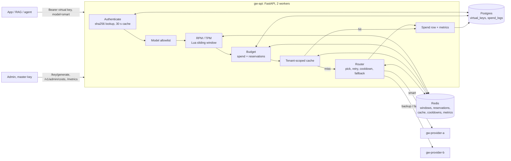
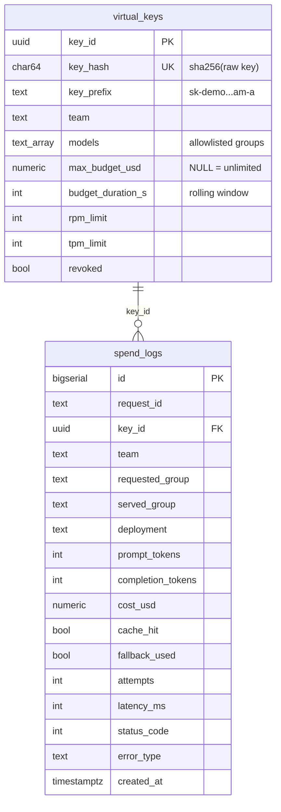

# LLM Gateway: system design

## 1. The problem

Every product team that calls an LLM ends up writing the same things: provider credentials in
their own config, their own retry loop, their own idea of what a request cost. The result is
credential sprawl, no central spend control, retry storms during provider incidents, and finance
asking "which team spent $4,000 last Tuesday?" with nobody able to answer.

**User story.** The RAG team (Project 1) wants "a good model" for answer generation. They get a
virtual key `sk-demo-team-a` scoped to `smart` and `backup`, capped at $5 per 30 days and 20 RPM.
When provider A has an outage at 2 a.m., their requests are answered by provider B without any
code change, and the cost report shows both that they asked for `smart` and that `backup` served it.

**Why naive approaches fail.**

- *Call the provider SDK directly from each app*: every app holds raw provider keys, and limits
  are per-process. Ten pods with "20 RPM" each allow 200 RPM.
- *A proxy with an in-memory cache and counters*: works for one worker, wrong for two. Cache hit
  rate drops by the number of replicas and rate limits stop meaning anything.
- *Retry everything*: a 400 for a malformed prompt is retried three times on two providers, and
  during an outage every client multiplies load on a provider that is already failing.
- *A global cache keyed on the prompt text*: team B gets team A's answer, generated under team
  A's system prompt and data. That is a data leak, not an optimisation.

## 2. Requirements

**Functional (core)**

1. OpenAI-compatible `POST /v1/chat/completions` (non-streaming) addressed by logical model group.
2. Virtual keys: hashed at rest, issued by an admin (`POST /key/generate`), scoped to a team,
   a model allowlist, a budget over a rolling window, and RPM/TPM limits.
3. Response cache scoped by team, model group, normalised messages, parameters and policy version.
4. Routing within a group, bounded retries on transient errors only, deployment cooldown, and
   a configured fallback group (`smart → backup`).
5. A spend row for every request: requested group, serving group, deployment, tokens, cost,
   cache hit, fallback, attempts, latency, status. Cost report by team / group / deployment.
6. Prometheus counters at `/metrics`.

**Out of scope**: streaming (SSE), embeddings, tool-call side-effect safety, OIDC for admins,
semantic (embedding) caching, provider-native prompt caching, multi-region.

**Non-functional (design targets, not measured results)**

| Concern | Target |
|---|---|
| Added latency (cache miss) | p95 < 15 ms of gateway overhead on top of the provider |
| Cache hit latency | p95 < 10 ms |
| Rate-limit correctness | No more than `limit` admitted per window across all workers/replicas |
| Budget overshoot | Bounded by one worst-case request per concurrent in-flight request (section 7.4) |
| Retry amplification | At most `(1 + num_retries) × (1 + fallback groups)` upstream calls per request; 4 here |
| Isolation | 0 cross-team cache hits; 0 provider calls for unauthenticated or unauthorised requests |
| Availability of state stores | Redis or Postgres down → fail closed (503) for admission; cache fails open |

## 3. Core entities

| Entity | Where | Notes |
|---|---|---|
| Virtual key | Postgres `virtual_keys` | `key_hash` (SHA-256), team, allowlisted groups, budget + window, RPM, TPM |
| Model group | `config/gateway.yaml` | Logical name the app asks for (`smart`, `backup`) |
| Deployment | `config/gateway.yaml` | Physical endpoint in a group: id, api_base, upstream model, timeout, prices |
| Spend log | Postgres `spend_logs` | One row per request, including rejections and cache hits |
| Rate window | Redis `rl:{key}:rpm|tpm:<minute>` | Two buckets per limit, sliding-window counter |
| Budget reservation | Redis `budget:{key}:reserved` | USD reserved by in-flight requests |
| Cache entry | Redis `cache:<team>:<group>:<sha256>` | Full response + serving group, TTL 300 s |
| Cooldown | Redis `cooldown:<deployment>`, `fails:<deployment>` | Deployment skipped while key exists |

## 4. API / system interface

| Method | Path | Auth | Purpose |
|---|---|---|---|
| POST | `/v1/chat/completions` | virtual key | OpenAI chat completion |
| POST | `/key/generate` | master key | Issue a virtual key (raw key returned once) |
| GET | `/v1/admin/costs?team=&days=30` | master key | Spend summary |
| GET | `/metrics` | master key | Prometheus text format |
| GET | `/healthz`, `/docs` | none | Health, Swagger |

```http
POST /v1/chat/completions
Authorization: Bearer sk-demo-team-a
{"model": "smart", "messages": [{"role": "user", "content": "..."}], "max_tokens": 200,
 "temperature": 0, "cache": {"no-cache": false, "no-store": false}}

200 OK
x-request-id: req-cd73e32245f045aa
x-gateway-model-group: smart            # what was requested
x-gateway-served-group: backup          # what answered (differs on fallback)
x-gateway-deployment: provider-b/mock-claude-haiku   # or "cache"
x-gateway-cache: hit | miss
x-gateway-fallback: true | false
x-gateway-attempts: 3                   # upstream calls made
x-gateway-cost-usd: 0.00006000
{"id": "chatcmpl-...", "object": "chat.completion", "choices": [...], "usage": {...}}
```

Errors use the OpenAI envelope `{"error": {"message", "type", "code"}}`:

| Status | `type` | When |
|---|---|---|
| 400 | `invalid_request_error` / `upstream_rejected` | bad body, unconfigured group, provider 400/404/413/422 |
| 401 | `authentication_error` | missing, malformed, unknown or revoked key |
| 402 | `budget_exceeded` | durable spend + in-flight reservations reach the cap |
| 403 | `permission_error` | group not in the key's allowlist; non-master on admin routes |
| 429 | `rate_limit_error` | RPM or TPM window full (`Retry-After` set) |
| 502 | `upstream_rejected` | provider returned an unexpected non-transient error (e.g. 401 from a bad provider key) |
| 503 | `no_healthy_deployment` / `dependency_unavailable` | all groups exhausted, or Redis/Postgres down |

`POST /key/generate` body: `{"team", "models", "key_alias", "max_budget", "budget_duration": "30d",
"rpm_limit", "tpm_limit"}` (the LiteLLM field names). Response includes `key` once.

## 5. High-level design



How each functional requirement is met:

1. **OpenAI shape**: `ChatRequest` accepts OpenAI fields and passes unknown ones through
   (`extra="allow"`); the provider response body is returned unchanged plus `x-gateway-*` headers.
2. **Virtual keys**: `/key/generate` creates `sk-<32 url-safe chars>`, stores `sha256(key)` and a
   display prefix. Every request hashes the bearer token and looks it up (`app/main.py: authenticate`).
3. **Cache**: `app/cache.py: cache_key` hashes team, group, normalised messages, every
   output-affecting parameter and `policy_version`. Only successful responses are cached.
4. **Routing**: `app/router.py: Router.route` loops over `[group, *fallbacks[group]]`, retries
   transient failures, puts failing deployments in cooldown, and never follows fallbacks transitively.
5. **Spend**: a `finally` block writes one `spend_logs` row for every outcome, so rejections and
   cache hits appear in the report with `cost_usd = 0`.
6. **Metrics**: counters live in a Redis hash, so both workers (and any replica) render the same totals.

## 6. Low-level design

### 6.1 Request lifecycle

```mermaid
sequenceDiagram
  autonumber
  participant App
  participant GW as gw-api
  participant PG as Postgres
  participant R as Redis
  participant A as provider-a (smart)
  participant B as provider-b (backup)
  App->>GW: POST /v1/chat/completions (Bearer key, model=smart)
  GW->>GW: sha256(key); per-worker auth cache (30 s)
  alt not cached
    GW->>PG: SELECT * FROM virtual_keys WHERE key_hash=$1 AND NOT revoked
  end
  Note over GW: unknown key → 401 (no provider call)<br/>group ∉ key.models → 403
  GW->>R: EVALSHA rate.lua (rpm, tpm, est. tokens)
  Note over GW: 'rpm'/'tpm' → 429 + Retry-After
  GW->>PG: SUM(cost_usd) over budget window
  GW->>R: EVALSHA reserve.lua (spent, budget, worst-case cost)
  Note over GW: over cap → 402
  GW->>R: GET cache:team-a:smart:<sha256>
  alt cache hit
    R-->>GW: cached response
    GW->>R: refund token estimate
  else miss
    GW->>R: MGET cooldown:* (smart deployments)
    GW->>A: POST /chat/completions
    alt transient (429/5xx/timeout)
      A-->>GW: 500
      GW->>R: INCR fails:provider-a → SET cooldown:provider-a EX 15
      GW->>A: retry once (jittered backoff), skipped if cooling down
      A-->>GW: 500
      GW->>B: fallback group backup
      B-->>GW: 200 + usage
    else non-transient (400)
      A-->>GW: 400
      Note over GW: return 400, no retry, no fallback
    end
    GW->>R: SET cache key EX 300 (unless no-store)
    GW->>R: INCRBY tpm bucket (actual − estimate)
  end
  GW->>PG: INSERT spend_logs (requested=smart, served=backup, deployment, tokens, cost, ...)
  GW->>R: release budget reservation; HINCRBY metrics
  GW-->>App: 200 + x-gateway-* headers
```

### 6.2 Router state per deployment

```mermaid
stateDiagram-v2
  [*] --> Healthy
  Healthy --> Failing: transient failure (fails:<id> INCR, EX 60)
  Failing --> Healthy: 60 s pass without more failures
  Failing --> Cooldown: fails > allowed_fails (1)
  Cooldown --> Healthy: cooldown:<id> expires (15 s)
  note right of Cooldown: skipped by every worker;\nno retries spent on it
```



### 6.3 Redis key design

| Key | Type | TTL | Written by | Purpose |
|---|---|---|---|---|
| `rl:{<key_id>}:rpm:<minute>` | int | 120 s | `rate.lua` | requests admitted in that minute bucket |
| `rl:{<key_id>}:tpm:<minute>` | int | 120 s | `rate.lua`, `adjust_tokens` | tokens (estimate, then corrected) |
| `budget:{<key_id>}:reserved` | float | 300 s | `reserve.lua` / `release.lua` | USD held by in-flight requests |
| `cache:<team>:<group>:<sha256>` | JSON string | 300 s | `ResponseCache.set` | response + served group + deployment |
| `fails:<deployment>` | int | 60 s | `mark_failure` | recent transient failures |
| `cooldown:<deployment>` | "1" | 15 s | `mark_failure` | deployment excluded from routing |
| `inflight:<deployment>` | int | none | `Router.call` | least-busy routing input |
| `metrics` | hash | none | `Metrics.inc` | Prometheus series → value |

`{<key_id>}` is a Redis Cluster hash tag: all keys touched by one Lua script land on one slot.

### 6.4 Postgres schema



Indexes: `(key_id, created_at)` for the budget query, `(team, created_at)` for the report. Full
DDL: `data/schema.sql`. Prompts and responses are deliberately **not** stored.

### 6.5 Algorithms

**Sliding-window counter** (`app/limits.py`). With `b = floor(now / 60)` and
`w = 1 − (now mod 60) / 60`, estimated use is

`used = count[b] + ceil(count[b−1] × w)`

and a request is admitted if `used + cost ≤ limit` (cost = 1 for RPM, estimated tokens for TPM).
Check and increment for both limits happen in one Lua script, which Redis runs atomically.

**Token estimate.** `prompt_est = chars / 4`, `completion_est = max_tokens or 256`. After the
response, the TPM bucket is corrected by `actual − estimate`; a cache hit refunds the estimate.

**Cost.** `cost = prompt_tokens × input_cost_per_token + completion_tokens × output_cost_per_token`,
using the **serving** deployment's prices (`app/config.py: cost_usd`).

**Budget admission.** `reserve = max over candidate deployments (group + fallback) of cost(prompt_est, completion_est)`;
admit iff `spent_db + reserved_redis < max_budget`, then add `reserve` to `reserved_redis`.
After the spend row is committed, the reservation is released.

**Retry classification** (`app/router.py: is_transient`). Transient: 408, 409, 429, any 5xx,
`httpx.TransportError` (timeouts, connection refused/reset). Passed through: 400, 404, 413, 422.
Anything else (e.g. 401 from a misconfigured provider key) becomes 502 without failover.

## 7. Deep dives

### 7.1 Distributed rate limiting

**Problem.** Two workers (and later N replicas) must agree on "20 requests per minute for this key"
under concurrency, without a lock service.

- **Bad**: in-process counters. Each worker enforces its own 20 RPM, so the real limit is
  `20 × workers × replicas` and depends on load-balancer luck.
- **Good**: Redis `INCR` + `EXPIRE` on a fixed minute bucket. Shared and atomic per command, but
  a burst at 12:00:59 and another at 12:01:00 gets 2× the limit in two seconds; and `GET` then
  `INCR` from the client is a race.
- **Great**: a sliding window with check-and-increment in one Lua script. A sorted-set log is
  exact but stores one member per request (expensive for TPM); a sliding-window *counter* uses
  two integers per limit and errs by a small, bounded amount at bucket edges. Token buckets
  (GCRA) are an alternative when smooth pacing matters more than per-minute semantics.

**This repo.** Sliding-window counter in Lua for RPM and TPM together (`RATE_LUA`), admitted only
if both pass, so a request rejected for TPM does not consume RPM. Proven by
`test_rpm_burst_is_limited_atomically_across_workers`: 8 concurrent requests against a 3 RPM key
across 2 workers yield exactly 3 × 200 and 5 × 429. TPM is enforced on an up-front estimate,
then corrected with real usage, because the real count is only known after the call.
Deployment-level `rpm`/`tpm` (provider capacity) is a different concern from key limits (who
may spend); this repo implements the key limits.

### 7.2 Cache correctness and isolation

**Problem.** A cache hit is a response generated for *someone else's* request. It is only safe
when every input that could change the answer, or who may see it, is identical.

- **Bad**: key on the last user message. Team B gets team A's answer; a system-prompt change
  serves stale answers; `temperature=0.9` and `0` share a response.
- **Good**: hash the full messages and model. Still shared across tenants, and no way to
  invalidate after a prompt-policy change except flushing Redis.
- **Great**: `sha256(tenant + model_group + normalised messages + all output-affecting params +
  policy/prompt version + data version)`, TTL, explicit bypass, only cache successes, and a
  tenant prefix so one tenant can be purged. For user-specific data (RAG over per-user ACLs),
  include the user or ACL version, or disable caching until isolation is proven.

**This repo.** `cache_key` includes team, group, normalised messages (CRLF and surrounding
whitespace only; case is preserved because it can change answers), every parameter except
`user`/`cache`/`stream`, and `policy_version` from config (bump it to invalidate everything).
Key prefix `cache:<team>:<group>:` allows per-team invalidation. `{"no-cache": true}` skips read,
`{"no-store": true}` skips write. Cache hits cost $0, are recorded as `cache_hit=true`, and refund
their TPM estimate but still consume RPM (a request is a request). Redis read/write errors
degrade to a miss. Proven by `test_cache_hits_on_repeat_and_is_never_shared_across_teams` and
`test_different_params_do_not_share_cache`. Caveat: P1 should include its tenant in the gateway
key (one key per tenant) for tenant-level cache isolation; here the team is the isolation unit.

### 7.3 Failover without retry storms

**Problem.** Provider A returns 500s. We want users to get answers from B, without (a) tripling
load on A while it is down, (b) retrying requests that can never succeed, or (c) loops.

- **Bad**: `for attempt in range(5): try A, then B` for every error. A 400 is sent 10 times; during
  an outage each request makes 5 doomed calls to A; nested fallbacks can cycle.
- **Good**: retry only 429/5xx/timeout, a fixed retry count, and a fallback list. Still every
  request pays the retries against A while it is known to be broken.
- **Great**: error classification + bounded retries with jittered backoff + **shared** circuit
  state (cooldown) so the whole fleet stops calling a failing deployment after a few failures +
  one-hop fallback to a *capability-compatible* group + a cap on total attempts + per-attempt timeouts.
  Respect `Retry-After`, and never retry calls that may have had side effects.

**This repo.** `num_retries: 1`, `allowed_fails: 1`, `cooldown_time: 15`, `fallbacks: smart →
[backup]`, timeout 2 s per call. Worst case is 4 upstream calls (2 per group). After a deployment
fails twice within 60 s, `cooldown:<id>` makes every worker skip it for 15 s, so the next request
goes straight to the fallback with `attempts=1`. Fallbacks are not transitive, and config parsing
rejects unknown or self-referencing groups. Proven by
`test_primary_fault_falls_back_to_backup_and_is_attributed` (500 and 429),
`test_cooldown_skips_failing_primary_on_next_request`, `test_single_timeout_is_retried_on_same_group`,
`test_bad_request_is_not_retried_or_failed_over` and
`test_both_providers_down_returns_503_with_bounded_attempts` (4 attempts, then 0 while both cool down).
Capability compatibility (`smart` and `backup` both plain chat) is a config-review concern here;
a production version would declare capabilities per group and refuse incompatible fallbacks.

### 7.4 Cost governance and budget races

**Problem.** "$5 per 30 days" must hold even when 50 requests from the same key arrive at once,
and fallback to a pricier model must count against the same budget.

- **Bad**: check `spent < budget` in Postgres, call the provider, then write spend. All 50
  concurrent requests read the same `spent` and pass; overshoot is unbounded by concurrency.
- **Good**: `UPDATE keys SET spend = spend + est WHERE spend + est <= budget` before the call
  (a reservation in Postgres). Correct, but a hot row per key and a DB write on the critical path.
- **Great**: reserve worst-case cost in a fast atomic store (Redis Lua) on top of durable spend
  in Postgres, settle with actual cost, release the reservation, alert well before the cap, and
  decide explicitly whether to fail open or closed when the stores are unavailable.

**This repo.** Admission is `spent_db + reserved < budget` in `RESERVE_LUA`, reserving the most
expensive candidate deployment's cost (so a fallback to `backup` is covered). The spend row is
written *before* the reservation is released, so there is no window in which a request's cost
is counted nowhere. Overshoot is bounded by how much the estimate under-counts: the request that
crosses the line is admitted (team-b's single long prompt spends $0.00087 of $0.0005), and later
ones are rejected with 402. Spend is computed from the serving deployment's price table, so
`smart` traffic served by `backup` is billed at backup's rate and attributed to both the
requested group and the real deployment. Postgres or Redis errors during admission return 503
(fail closed: no limits checked means no spend). Proven by `test_budget_exhaustion_rejects_with_402`.
Known simplification: `SUM(cost_usd)` per request is fine at demo scale; at scale keep a rolling
per-key counter (Redis or a daily rollup table) and reconcile with the logs.

## 8. Real vs simulated

| Production component | This repo | Notes |
|---|---|---|
| LiteLLM Proxy | Own FastAPI gateway (`app/`) | Same config shape and key fields; LiteLLM needs Prisma migrations and real keys, which makes an offline demo fragile |
| Provider A / B (OpenAI, Anthropic) | `mock_provider` image run twice | Deterministic replies, `usage` ≈ chars/4, `/admin/fault` for 429/500/timeout |
| Real upstream | Optional `REAL_UPSTREAM_*` env for `smart` | Off by default |
| Redis | **Real** `redis:7.4-alpine` | Lua scripts, TTLs, cache, cooldowns, metrics |
| PostgreSQL | **Real** `postgres:16-alpine` | Keys (hashed) and spend logs |
| Secrets manager | Env vars with demo values | Provider keys are `mock-key-a/b` |
| Admin OIDC / RBAC | Static master key `sk-master-demo` | Compared with `hmac.compare_digest` |
| Metrics backend | `/metrics` text format, no Prometheus server | Counters only; no latency histograms |
| Tracing | Structured JSON log line per request with `request_id` | No OpenTelemetry |
| Pricing data | Static per-deployment prices in YAML | Real prices change; LiteLLM ships a price map |

Differences from real LiteLLM worth knowing: LiteLLM keeps spend in a counter on the key/team
rows (updated through a transaction buffer) rather than summing logs; it supports many more
routing strategies, per-deployment `rpm`/`tpm`, streaming, and `/key/update` / `/key/delete`.
This gateway returns 402 for budget exhaustion where LiteLLM returns a 400/429-style budget error.

## 9. Failure modes and testing

| Failure | Behaviour | Test |
|---|---|---|
| Missing / unknown / malformed key | 401 before any provider call | `test_invalid_key_is_401_before_any_provider_call` |
| Group outside allowlist (incl. prompt "I am an admin") | 403, no provider call | `test_team_b_cannot_use_smart`, `test_unknown_model_is_rejected_by_allowlist_not_proxied` |
| Budget exhausted | 402 `budget_exceeded` | `test_budget_exhaustion_rejects_with_402` |
| Concurrent burst over RPM | Exactly `limit` admitted across workers | `test_rpm_burst_is_limited_atomically_across_workers` |
| Request larger than TPM | 429 before provider call | `test_tpm_limit_counts_requested_completion_tokens` |
| Same prompt, other team | Cache miss, provider called | `test_cache_hits_on_repeat_and_is_never_shared_across_teams` |
| Primary 500 / 429 | Retry once, fallback to backup, attributed to both | `test_primary_fault_falls_back_to_backup_and_is_attributed` |
| Primary keeps failing | Cooldown; next request skips it | `test_cooldown_skips_failing_primary_on_next_request` |
| Single timeout | Retried in the same group | `test_single_timeout_is_retried_on_same_group` |
| Provider 400 | Returned as-is, 1 attempt | `test_bad_request_is_not_retried_or_failed_over` |
| All providers down | 503 after 4 attempts; 0 attempts while cooling down | `test_both_providers_down_returns_503_with_bounded_attempts` |
| Non-master on admin routes | 403 / 401 | `test_key_generate_requires_master_and_stores_only_hash`, `test_admin_endpoints_reject_virtual_keys` |
| Raw key at rest | Only SHA-256 stored | `test_key_generate_requires_master_and_stores_only_hash`, `test_keys_are_stored_as_sha256` |
| Bad config (unset env, bad fallback, bad strategy) | Startup fails fast | `test_unset_env_reference_fails_fast`, `test_invalid_fallbacks_are_rejected` |
| Redis down | Admission returns 503; cache errors degrade to miss | Not automated (would require stopping Redis mid-suite) |
| Postgres down | 503 for uncached keys; auth cache keeps known keys for ≤ 30 s, but spend write fails → 503 | Not automated |

Run: `docker compose run --rm gw-api pytest -q` (unit tests need no services; integration tests
are skipped unless `GW_URL` is set, which compose does). Each integration test generates its own
team and key and resets provider faults and cooldowns.

## 10. Interview cheat sheet

**60-second pitch.** I built an OpenAI-compatible LLM gateway modelled on LiteLLM Proxy. Apps
use a virtual key and a logical model group; the gateway authenticates the key by SHA-256 hash
in Postgres, enforces a model allowlist, per-key RPM and TPM with an atomic Lua sliding window in
Redis, and a dollar budget using durable spend in Postgres plus in-flight reservations in Redis.
It serves repeats from a tenant-scoped Redis cache, routes misses to a deployment, retries only
transient errors, cools down failing deployments fleet-wide, and falls back `smart → backup`.
Every request writes a spend row with both the requested group and the real deployment, so
fallback cost is visible. It runs offline with real Redis and Postgres and fault-injectable mock
providers, and the tests prove isolation, bounded retries and budget behaviour.

**Likely questions**

1. *Why Redis and Postgres both?* Redis holds shared, short-lived, high-rate state (windows,
   reservations, cooldowns, cache) that every worker must see; Postgres holds durable, auditable
   state (keys, spend) that finance and budgets depend on.
2. *Why not fixed windows?* Boundary bursts allow 2× the limit. The sliding-window counter costs
   two integers and bounds the error; a sorted-set log is exact but heavier for token counts.
3. *How do you enforce TPM before you know the token count?* Estimate (chars/4 + max_tokens),
   admit on the estimate, correct with actual usage afterwards; refund on cache hits.
4. *What goes into the cache key and why?* Team, group, normalised messages, output-affecting
   params, policy version. Anything that changes the answer or its audience must be in the key.
5. *What errors trigger fallback?* 408/409/429/5xx and transport errors. 4xx caller errors never
   do: a malformed prompt fails the same way on every provider.
6. *How do you prevent retry storms?* Bounded attempts (max 4), jittered backoff, and a shared
   cooldown so after 2 failures in 60 s the whole fleet skips that deployment for 15 s.
7. *How can a budget be overshot?* By in-flight requests whose real cost exceeds the estimate,
   bounded per request. Reservations stop concurrency from multiplying the overshoot.
8. *What happens if Redis is down?* Admission fails closed (503): no limits means no spend. The
   cache fails open. The trade-off is availability; some teams choose fail-open with alerts.
9. *How is fallback cost attributed?* Spend rows store `requested_group`, `served_group` and
   `deployment`, priced at the serving deployment's rate.
10. *Why build this instead of running LiteLLM?* For an offline, deterministic demo; in production
    I would run LiteLLM (or Envoy AI Gateway) with this exact config shape and keep these tests as
    contract tests against it.

**Trade-offs made.** Per-worker auth cache (30 s revocation lag) vs a Postgres hit per request;
budget from `SUM(spend_logs)` (simple, exact) vs a counter (fast at scale); fail-closed admission
vs availability; exact-match cache (safe, low hit rate) vs semantic cache (higher hit rate, harder
to make correct); non-streaming only.

**Scaling story.** *10x*: more gw-api replicas behind a load balancer (state is already in
Redis/Postgres), connection pooling, a per-key spend counter instead of `SUM`, async spend writes
through a buffer (Redis stream → batch insert) with reconciliation. *100x*: Redis Cluster (keys
already carry `{key_id}` hash tags), partition `spend_logs` by month and roll up daily, per-region
gateways with region-local Redis and a global budget ledger, streaming with incremental token
accounting, latency histograms and OpenTelemetry traces.

**Resume bullet.** Built a multi-provider, OpenAI-compatible LLM gateway (FastAPI, Redis,
PostgreSQL) with hashed virtual keys, atomic Redis Lua RPM/TPM limits, budget reservations,
tenant-scoped response caching and transient-only retries with fleet-wide cooldown and fallback;
handled **[measured]** RPM at **[measured]** ms p95 overhead with a **[measured]** cache hit rate,
validated by fault-injection tests covering failover, isolation and budget boundaries.
